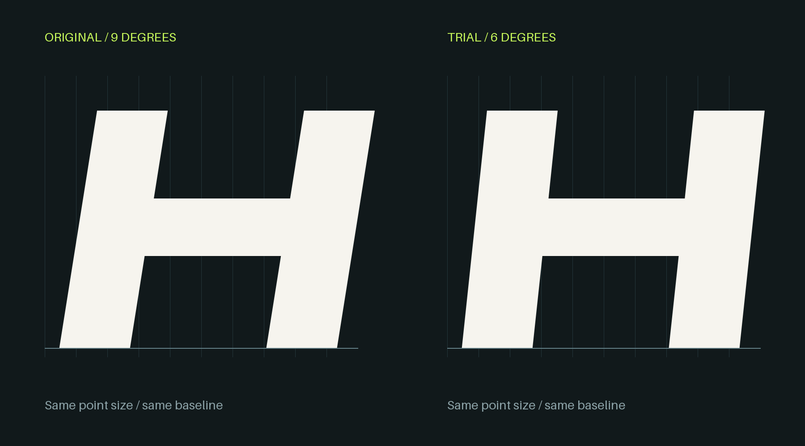
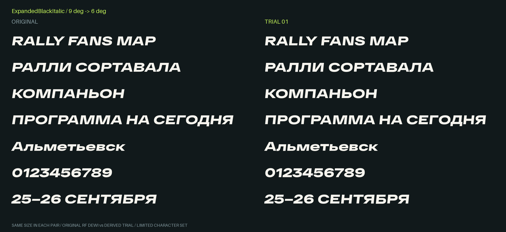
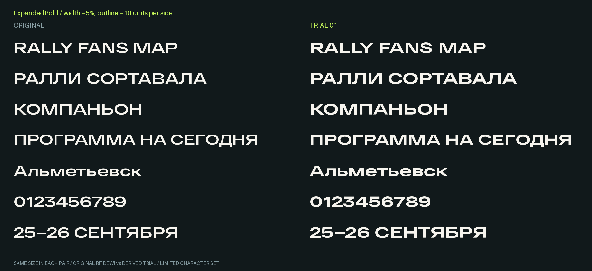
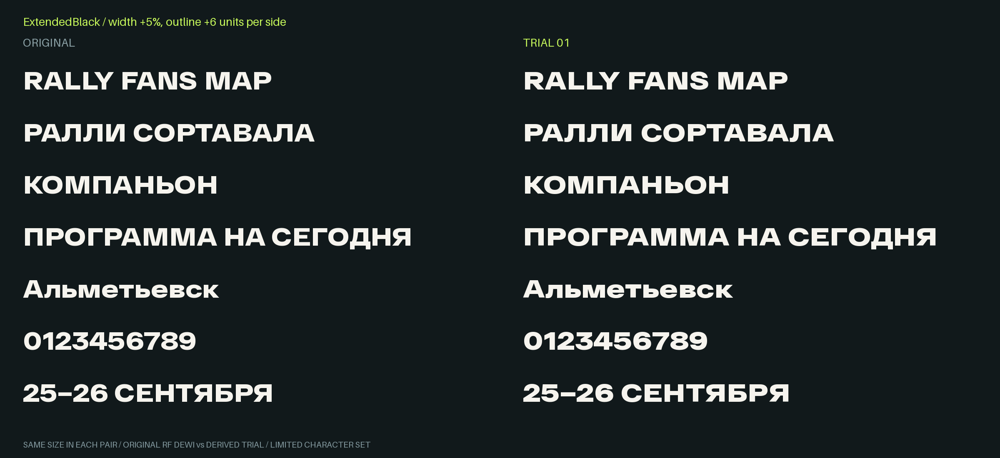

# RF Dewi — проба изменений 01

Модификации присланных RF Dewi; это не самостоятельный шрифт RFM Sans. Оригинальные TTF сохранены без изменений и здесь не публикуются. Все образцы ниже отрендерены из исходных и изменённых TTF при одинаковом кегле.

## Файлы

[Скачать весь комплект](./RF-Dewi-RFM-Trial-01.zip): три TTF, три WOFF2, модифицированные векторные контуры и SVG, скрипты сборки/проверки, CSS и инструкция.

Отдельные TTF:

- [Expanded Bold — жирнее и шире](./RFDewiRFMTrial01-ExpandedBold.ttf)
- [Extended Black — жирнее и шире](./RFDewiRFMTrial01-ExtendedBlack.ttf)
- [Expanded Black Italic — уменьшенный наклон](./RFDewiRFMTrial01-ExpandedBlackItalic.ttf)

Для скачивания со страницы файла нажмите **Download raw file**.

## Italic: наклон 9° → 6°

Толщина и длина строки сохранены. Большая контрольная буква:

## Expanded Bold: жирнее и шире

Горизонтальный масштаб +5%, утолщение по 10 единиц наружу, с компенсацией высоты прописных. Контрольные вертикали Н: 156 → 183 единицы. Длина RALLY FANS MAP +7.5% с учётом утолщения и интервалов.

## Extended Black: жирнее и шире

Горизонтальный масштаб +5%, утолщение по 6 единиц наружу, с компенсацией высоты прописных. Контрольные вертикали Н: 197 → 219 единиц. Длина RALLY FANS MAP +6.7%.

## Что проверено

Исходники неизменны. TTF/WOFF2 читаются повторно; пересборка воспроизводит те же файлы. Все семь строк отрендерены, контрольные просветы сохранены, вертикальные метрики вмещают контуры, реальный наклон измерен примерно как 9° → 6°.

Это пробники на **47 символов** семи строк, а не полный алфавит (исходники содержат 473 кодовые точки). Нет испытаний установки в Figma/Windows/macOS или полной оптической доводки. Новые внутренние имена содержат RF Dewi RFM Trial 01 и не конфликтуют с оригиналами.

После согласования параметров — перенос на полное покрытие и проверка остальных символов. Предыдущие оригинальные исследования RFM Sans сохранены отдельно в папках rfm-sans-stage1 и rfm-sans-stage2.
