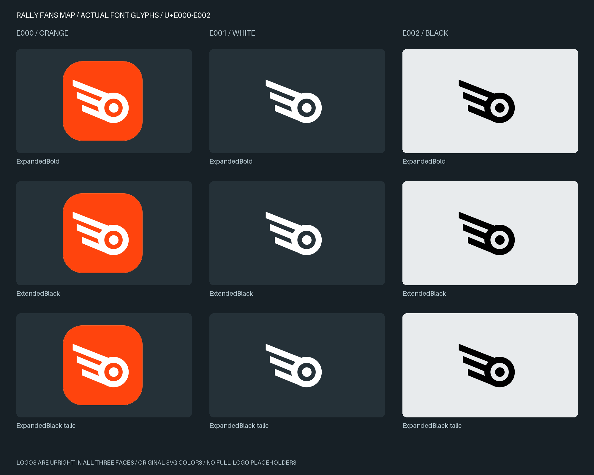

# RFM — миниатюра встроена в шрифты

Три символа из присланного Logo icon.svg добавлены в Expanded Bold, Extended Black и Expanded Black Italic предыдущей пробы. Начертания букв и кернинг не изменены. Это модифицированные RF Dewi с логотипом RFM.

[Скачать весь комплект](./RFM-Logo-Symbols-01.zip) — три TTF, три WOFF2, исходный SVG и три SVG-варианта, скрипты сборки, CSS и инструкция.

## Установка

- [Expanded Bold с логотипом](./RFDewiRFMLogo01-ExpandedBold.ttf)
- [Extended Black с логотипом](./RFDewiRFMLogo01-ExtendedBlack.ttf)
- [Expanded Black Italic с логотипом](./RFDewiRFMLogo01-ExpandedBlackItalic.ttf)

Новые семейства: RF Dewi RFM Logo 01 Expanded / Extended. Они отличаются именами от предыдущих проб. Для скачивания файла на его странице нажмите Download raw file.

## Символы для копирования

| Unicode | Символ | Вид |
|---|---|---|
| U+E000 |  | белый знак на рыжей подложке |
| U+E001 |  | белый без подложки |
| U+E002 |  | чёрный без подложки |

[Текстовый файл с символами](./symbols.txt) · [Автономная HTML-страница для просмотра и копирования](./symbols.html) — скачайте HTML и откройте локально.

Логотипы прямые и одинаковые во всех трёх начертаниях. В SVG сохранены и основная рыжая заливка #FF440D, и обводка #FF6228. У белого и чёрного знаков прозрачный фон; тёмные/светлые карточки на превью — только демонстрация.

## Совместимость и проверка

Цвета записаны в COLR v0 / CPAL. Проверены рендер фиксированных цветов, прозрачность, чтение TTF/WOFF2, повторяемость сборки из приложенных входов, сохранность старых контуров/метрик/кернинга и отсутствие наклона у логотипа в Italic. Проверка в Figma ещё не выполнена: если приложение не поддерживает COLR/CPAL, отображается монохромный fallback. Для такого случая доступны отдельные SVG:

[Рыжая миниатюра](./icon-orange.svg) · [Белая миниатюра](./icon-white.svg) · [Чёрная миниатюра](./icon-black.svg)

Покрытие пробников: прежние 47 символов + 3 миниатюры = 50 кодовых точек. Полный логотип ещё не добавлен — нужен его SVG. Позиции U+E003–U+E005 остаются свободными, заглушек нет.
