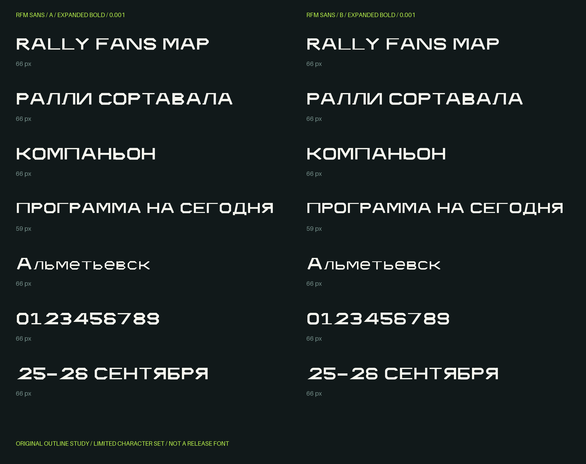

# RFM Sans — первый этап

Прототипы Expanded Bold: A — Facet (угловатый), B — Circuit (округлый).
Предварительно рекомендуется B. Это ограниченные тестовые шрифты, не готовое семейство.

- [Скачать полный архив](./RFM-Sans-Stage1.zip): TTF/WOFF2 обоих направлений, редактируемые контуры и метрики, SVG-глифы, сборщик, зависимости, CSS и инструкция.
- [Скачать TTF B](./RFMSansStudyB-ExpandedBold.ttf)
- [Скачать TTF A](./RFMSansStudyA-ExpandedBold.ttf)

На странице файла в GitHub используйте **Download raw file** для скачивания.

Каждый шрифт содержит 47 символов, покрывающих семь заданных строк. Полного алфавита пока нет. Контуры созданы самостоятельно, RF Dewi не использовался как источник очертаний. Скриншоты референсов не были предоставлены.

Проверены сборка и повторное открытие TTF/WOFF2, повторяемость сборки, покрытие пробных строк, вертикальные границы и эффект начальных пар кернинга. Превью отрендерено непосредственно из TTF. Установка в Figma и на Windows/macOS не проверена. Строчные, стыки, цифры и интервалы требуют оптической доводки.

Полный список Unicode, результаты проверок и инструкции находятся внутри архива. Дальнейшая разработка семейства — после выбора направления.
