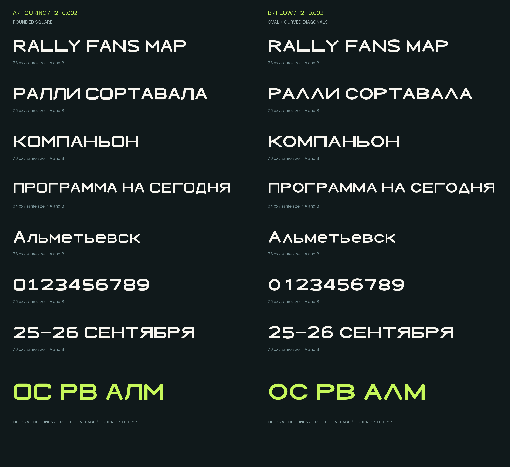
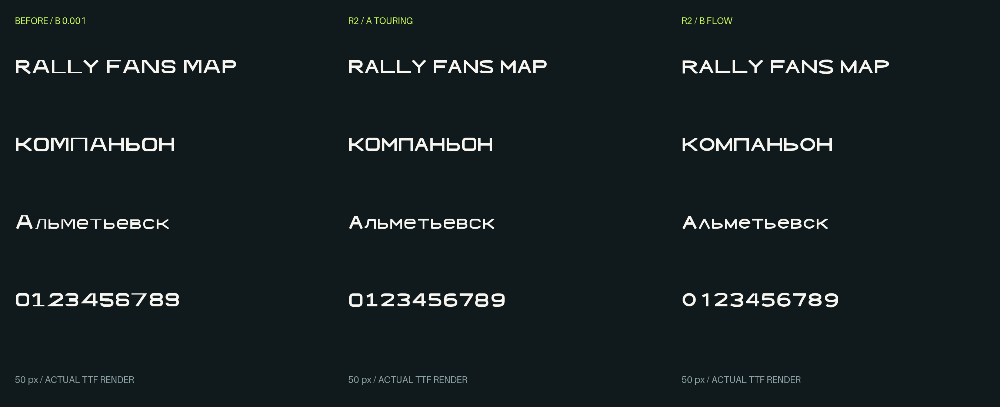

# RFM Sans — новая проба R2 / 0.002

Исправления после первой пробы: кривые вместо фасеточных чаш, согласованная толщина основных штрихов, заново построенные цифры, Р/В и строчные. Два варианта теперь различаются конструкцией.

- **A — Touring:** скруглённые прямоугольные О/С/0, компактные чаши Р/В, плоский верх Л, прямые диагональные ветви.
- **B — Flow:** овальные О/С/0, широкие чаши Р/В, треугольная Л, более плавные ветви К/R и глубокая середина М.

[Скачать архив с TTF, WOFF2, исходниками и SVG](./RFM-Sans-R2.zip)

[Тестовый TTF A](./RFMSansStudyAR2-ExpandedBold.ttf) · [Тестовый TTF B](./RFMSansStudyBR2-ExpandedBold.ttf)

На странице файла используйте **Download raw file**, если скачивание не началось автоматически.

## Новые A и B

Одинаковый кегль в каждой паре строк. Превью отрендерено из созданных TTF.

## Было / стало

Слева прежний B 0.001, в центре новый A, справа новый B, одинаковый кегль.

Проверены повторная сборка в отдельном Python-окружении с указанными зависимостями, идентичность файлов при пересборке, чтение TTF/WOFF2, cmap и контуры, вертикальные границы, начальный кернинг, рендер всех семи строк. На контрольных сечениях О и Н основные штрихи по 132 единицы, перемычка Н 120 с оптической компенсацией. Это выборочная проверка, а не подтверждение полной оптической готовности.

Покрытие прежнее — 47 символов. Полного алфавита и остальных четырёх начертаний пока нет. Требуется дальнейшая ручная доводка стыков, пропорций и интервалов; Figma/Windows/macOS не проверены. Отдельные имена R2 позволяют отличить новые шрифты от первой пробы. Предыдущие файлы сохранены в соседней папке rfm-sans-stage1.
